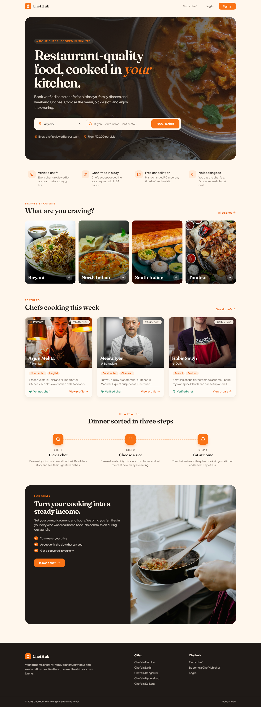
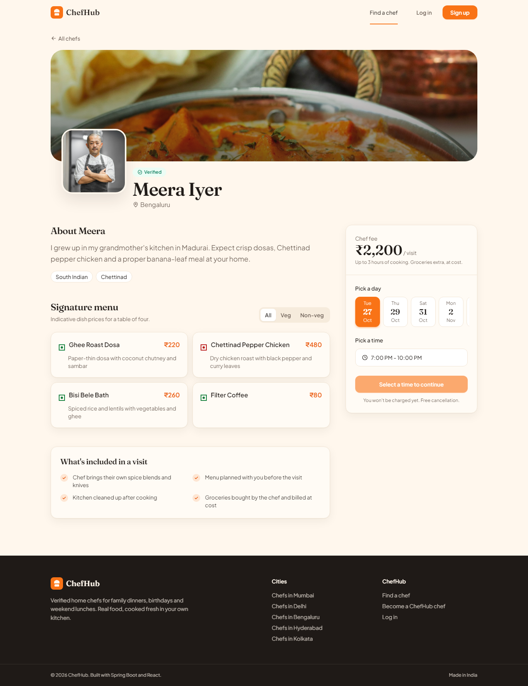
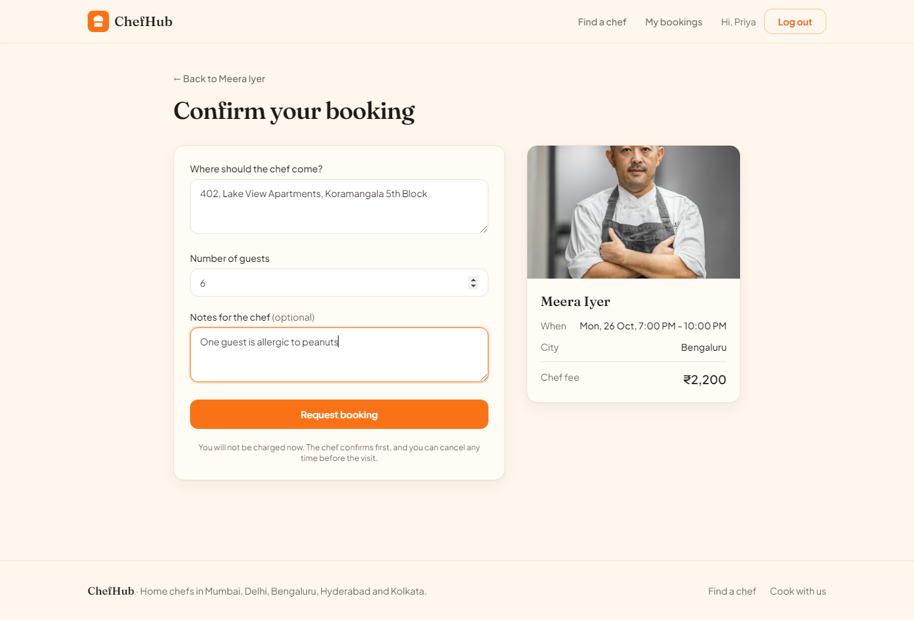
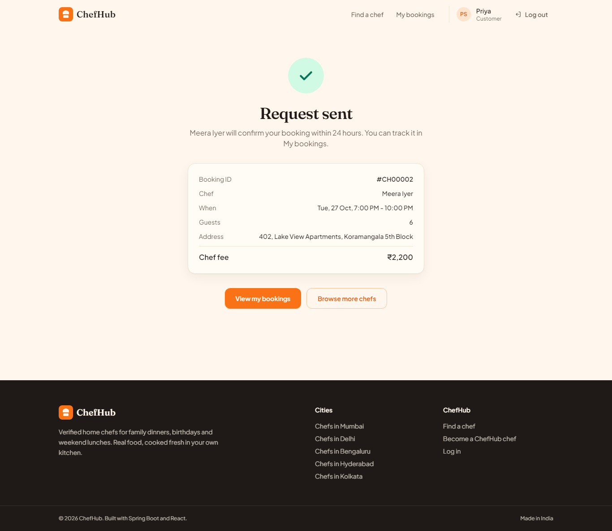
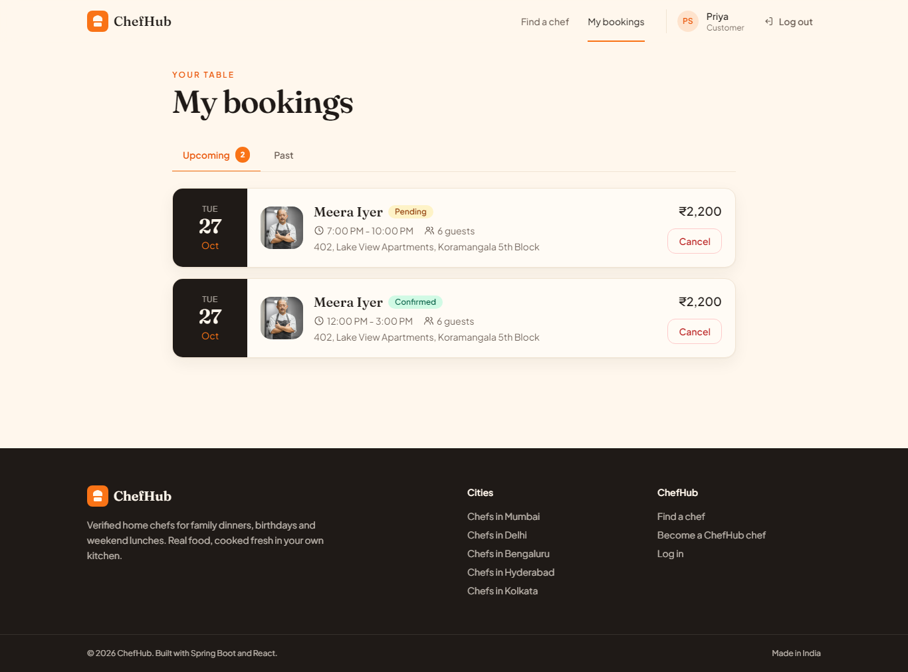
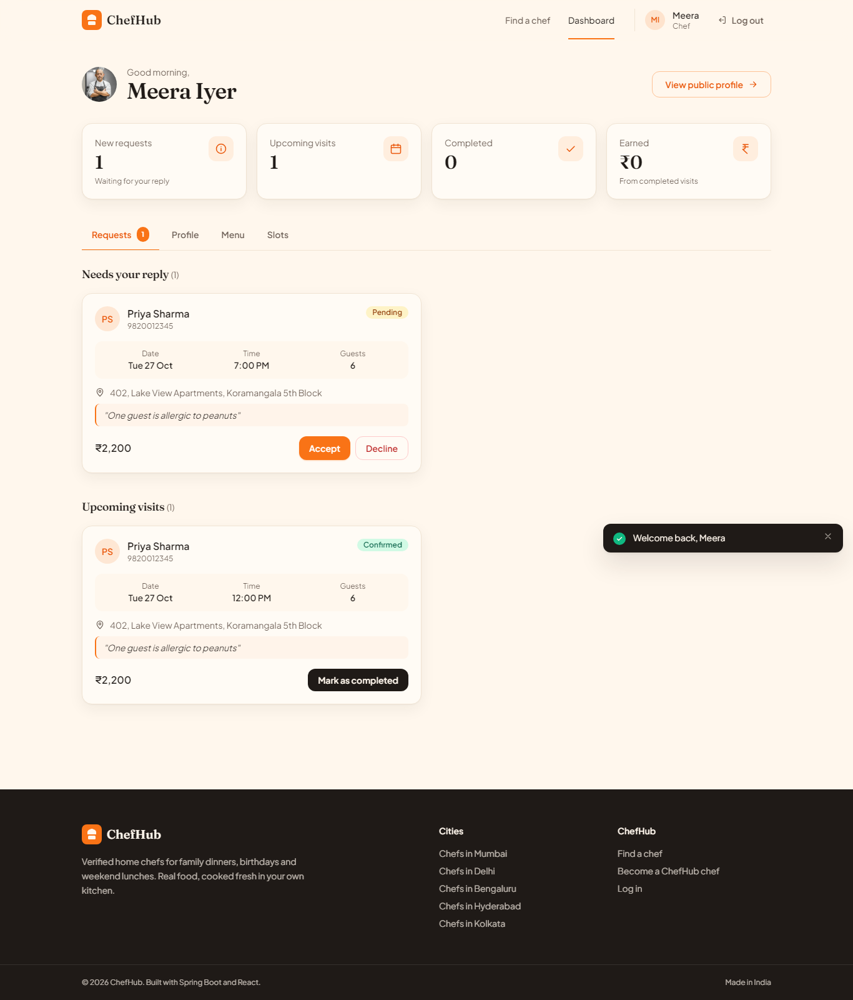
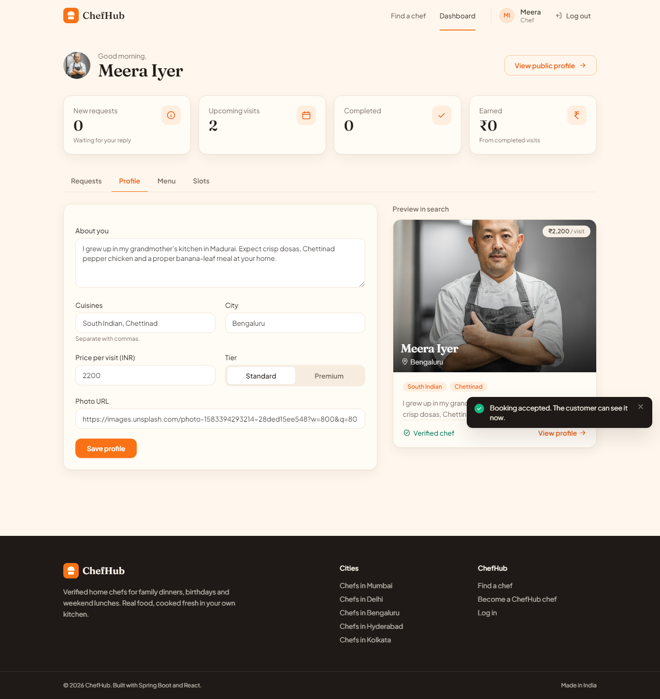
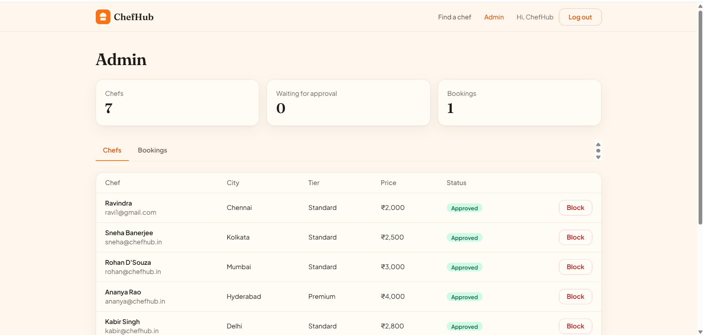
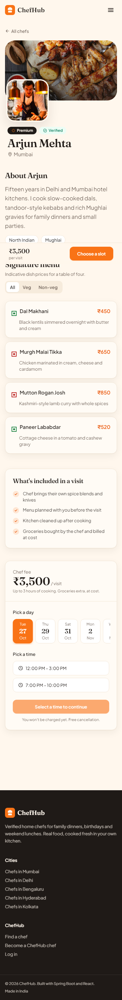
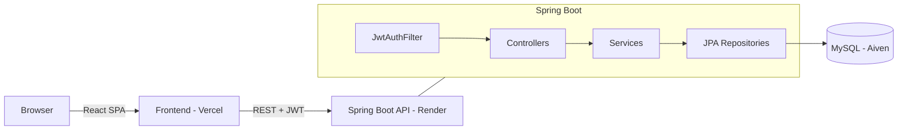

# ChefHub

ChefHub is a booking platform for home chefs. Customers search for chefs by city, cuisine and tier, look at their menu and open slots, and book a visit to their home. Chefs manage their profile, dishes, availability and incoming requests. An admin approves or blocks chefs and can see every booking.

I built it as a full-stack portfolio project to practise Spring Boot, Spring Security with JWT, JPA and a React frontend.

**Live demo:** https://chefhub-rose.vercel.app
**API docs (Swagger):** https://chefhub-ozlh.onrender.com/swagger-ui.html

The backend runs on Render's free tier, so the first request after a while can take about a minute while the server wakes up.

## Screenshots



| Chef profile with day and time picker | Booking with price breakdown |
|---|---|
|  |  |

| Booking confirmed | My bookings |
|---|---|
|  |  |

| Chef dashboard | Chef profile editor with live preview |
|---|---|
|  |  |

| Admin dashboard | Mobile |
|---|---|
|  |  |

## Features

- Register and log in as a customer or chef, with JWT auth and role-based access (CUSTOMER, CHEF, ADMIN)
- Chef profile: bio, cuisines, price per visit, city, photo, Standard or Premium tier, admin approval
- Chef menu items (veg or non-veg) and availability slots
- Paginated chef search filtered by city, cuisine and tier
- Booking with address, guest count and notes. The service locks the slot row inside a transaction, so the same slot can't be booked twice
- Booking status flow: `PENDING -> CONFIRMED / REJECTED -> COMPLETED`; customers can cancel while a booking is pending or confirmed
- Admin dashboard to approve or block chefs and view all bookings

## Tech stack

| Layer    | Tech |
|----------|------|
| Backend  | Java 17, Spring Boot 3.5, Spring Security, JWT (jjwt), Spring Data JPA, Bean Validation, Lombok, springdoc-openapi |
| Database | MySQL 8 |
| Frontend | React 18, Vite, React Router, Axios, Tailwind CSS |
| DevOps   | Docker (multi-stage), docker-compose, Render, Aiven, Vercel |

## Architecture



Backend packages under `com.chefhub`:

- `controller` handles REST endpoints only, with no business logic
- `service` holds all the business rules (booking checks, status transitions, ownership checks)
- `repository` contains the Spring Data JPA interfaces
- `entity` has User, ChefProfile, MenuItem, AvailabilitySlot and Booking
- `dto` has the request/response records; entities are never returned from the API
- `security` has the JWT service, the auth filter and the user details service
- `config` has security/CORS, OpenAPI and the demo data seeder
- `exception` has the custom exceptions and the global handler

## Run locally

### Option 1: Docker (easiest)

```bash
docker compose up --build
```

The API runs at http://localhost:8080 and Swagger UI at http://localhost:8080/swagger-ui.html. MySQL is exposed on port 3307.

Then start the frontend:

```bash
cd frontend
npm install
npm run dev
```

Open http://localhost:5173.

### Option 2: Without Docker

Requirements: Java 17+, Node 18+, MySQL 8 running locally.

```bash
cd backend
# set your MySQL password (or put spring.datasource.password=... in backend/local.properties, which is gitignored)
export DB_PASSWORD=yourpassword        # PowerShell: $env:DB_PASSWORD="yourpassword"
./mvnw spring-boot:run                 # Windows: mvnw.cmd spring-boot:run
```

The database `chefhub` is created automatically and seeded on first start.

```bash
cd frontend
cp .env.example .env
npm install
npm run dev
```

### Environment variables

| Variable | Default | Used for |
|----------|---------|----------|
| `DB_URL` | `jdbc:mysql://localhost:3306/chefhub?...` | JDBC URL |
| `DB_USERNAME` | `root` | DB user |
| `DB_PASSWORD` | `root` | DB password |
| `JWT_SECRET` | dev key | Base64 key, at least 32 bytes |
| `ALLOWED_ORIGIN` | `http://localhost:5173` | CORS origin(s), comma separated |
| `VITE_API_URL` | `http://localhost:8080` | Frontend: backend base URL |

### Tests

```bash
cd backend
./mvnw test
```

`BookingServiceTest` covers double booking, cancellation and the status transitions.

## Demo logins

| Role | Email | Password |
|------|-------|----------|
| Admin | admin@chefhub.in | admin123 |
| Customer | priya@example.com | password123 |
| Customer | rahul@example.com | password123 |
| Chef (Mumbai) | arjun@chefhub.in | password123 |
| Chef (Bengaluru) | meera@chefhub.in | password123 |

Other chefs: kabir@, ananya@, rohan@ and sneha@chefhub.in, all with password123.

## Main API endpoints

| Method | Path | Access |
|--------|------|--------|
| POST | `/api/auth/register`, `/api/auth/login` | Public |
| GET | `/api/chefs?city=&cuisine=&tier=&page=&size=` | Public |
| GET | `/api/chefs/{id}` | Public |
| GET/PUT | `/api/chef/profile` | Chef |
| GET/POST/PUT/DELETE | `/api/chef/menu` | Chef |
| GET/POST/DELETE | `/api/chef/slots` | Chef |
| GET | `/api/chef/bookings`, PATCH `/api/chef/bookings/{id}/status` | Chef |
| POST | `/api/bookings`, GET `/api/bookings/my`, PATCH `/api/bookings/{id}/cancel` | Customer |
| GET | `/api/admin/chefs`, `/api/admin/bookings` | Admin |
| PATCH | `/api/admin/chefs/{id}/approve`, `/api/admin/chefs/{id}/block` | Admin |

You can find the full docs in Swagger UI.

## Deployment

| Part | Platform |
|------|----------|
| Frontend | Vercel (redeploys on every push to `main`) |
| Backend | Render, Docker web service |
| Database | Aiven MySQL |

Step-by-step setup is in [docs/deployment.md](docs/deployment.md). To see how a booking travels from the React button to the database, read [docs/booking-flow.md](docs/booking-flow.md).

## Future improvements

- Online payments (Razorpay) with an advance deposit
- Reviews and ratings after completed bookings
- Email/SMS notifications when a booking status changes
- Photo upload to cloud storage instead of URLs
- Flyway migrations instead of `ddl-auto=update`
- Refresh tokens and password reset
- Integration tests with Testcontainers
